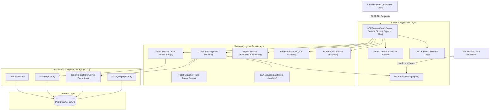
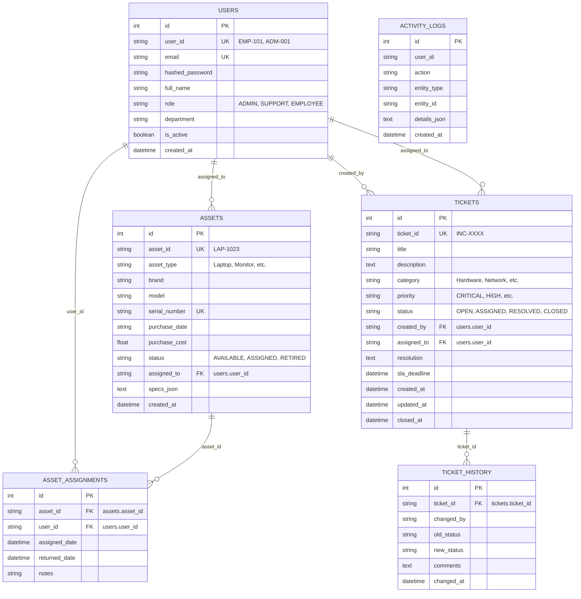

# Smart IT Asset & Support Ticket Management System

[](https://www.python.org/)
[](https://fastapi.tiangolo.com/)
[](https://pylint.org/)
[](https://docs.pytest.org/)
[]()

A production-style enterprise IT Asset Management and Support Ticket Lifecycle platform developed with **Python + FastAPI**, relational database persistence (**PostgreSQL & SQLite**), real-time **WebSockets**, rule-based ticket classification, and a modern reactive dashboard interface.

---

## 1. Project Overview

Modern enterprise organizations face continuous overhead tracking physical hardware assets (workstations, monitors, peripherals, printers) and addressing employee technical incidents. This platform provides an end-to-end automated solution enabling:

1. **Employees:** View assigned hardware assets, raise support incident tickets, track resolution progress with live SLA timers, and close tickets.
2. **IT Support Engineers:** View open incident queues, claim and progress tickets, inspect hardware specifications, submit technical resolutions, and monitor breach deadlines.
3. **IT Administrators:** Complete authority over user provisioning, asset registration, asset assignment/returns/retirement, audit activity inspection, batch file processing, and analytical reporting.

---

## 2. Key Features

- **Object-Oriented Asset Hierarchy:** Polymorphic hardware models (`Laptop`, `Monitor`, `Keyboard`, `Mouse`, `Printer`) demonstrating **Inheritance**, **Encapsulation**, **Polymorphism**, and **Composition** (Warranty components).
- **Rule-Based Automatic Classification:** Categorizes tickets (`Hardware`, `Software`, `Network`, `Access`) and determines urgency (`CRITICAL`, `HIGH`, `MEDIUM`, `LOW`) using regex, string manipulation, `lambda`, and `filter` without relying on external AI.
- **SLA Management Engine:** Real-time deadline calculation, breach detection, resolution time tracking, and enterprise compliance reporting using `datetime` and `timedelta`.
- **Memory-Efficient Data Generators:** Streams analytical datasets and CSV exports chunk-by-chunk using Python generators (`yield`) with $O(1)$ memory consumption.
- **Custom Decorator Subsystem:** Reusable cross-cutting decorators for performance profiling (`@measure_execution_time`), structured audit logging (`@log_activity`), and role enforcement (`@login_required`, `@admin_required`).
- **Resilient File I/O & OS Archiving:** Reads, parses, deduplicates, and calculates line/word/char statistics for batch flat files (`employees.txt`, `assets.txt`, `tickets.txt`) and safely archives them with the `os` module.
- **External API Consumer:** Consumes remote REST APIs via `requests` with robust handling for 200 OK, Timeout, Connection Errors, HTTP Errors (4xx/5xx), and malformed payloads.
- **Real-Time WebSocket Feed:** Persistent bi-directional channel broadcasting live events (`TICKET_CREATED`, `TICKET_ASSIGNED`, `TICKET_RESOLVED`, `TICKET_CLOSED`) directly to connected frontend clients without HTTP polling.
- **Role-Based Access Control (RBAC):** JWT Bearer token authentication with password hashing using NIST-approved PBKDF2-HMAC-SHA256 with per-user salt.

---

## 3. High-Level Architecture

The application strictly implements a **Layered / MVC Architecture** enforcing clear separation of concerns across presentation, business logic, data persistence, and real-time streaming:



---

## 4. Software Engineering Practices

### 4.1 SOLID Principles Demonstrated

| Principle | Demonstration in Project | File Reference |
|---|---|---|
| **S — Single Responsibility** | Every class has one focused duty: `SLAService` calculates time metrics, `TicketClassifier` categorizes text, `FileProcessorService` manipulates files. | `app/services/` |
| **O — Open / Closed** | Adding a new hardware device type (e.g. `Tablet`) simply extends the base `Asset` class without altering existing asset logic. | `app/models/domain_assets.py` |
| **L — Liskov Substitution** | Child asset classes (`Laptop`, `Monitor`, `Keyboard`) can seamlessly substitute base `Asset` instances across all depreciation and specification workflows. | `app/models/domain_assets.py` |
| **I — Interface Segregation** | Repositories expose focused, entity-specific query methods rather than monolithic database query abstractions. | `app/database/repositories.py` |
| **D — Dependency Inversion** | Business services depend on abstract repositories and database session interfaces rather than direct raw SQL driver calls. | `app/services/` |

### 4.2 Design Patterns

1. **Singleton Pattern:**
   - **Configuration Manager (`app/config.py`):** Guarantees a single loaded configuration instance in memory across threads via thread-safe double-checked locking, avoiding repeated disk environment parsing.
   - **Database Connection Manager (`app/database/connection.py`):** Manages a single shared SQLAlchemy Engine and connection pool throughout the application lifecycle.
   - **Logger Manager (`app/utils/logger.py`):** Centralizes application log handler initialization.
2. **Factory Method Pattern:**
   - **Domain Asset Factory (`app/services/asset_service.py`):** Polymorphically constructs appropriate concrete hardware classes (`Laptop`, `Monitor`, etc.) from serialized database records.
3. **Repository Pattern:**
   - Decouples database dialect details and schema queries from service business logic.

### 4.3 Database ACID Properties

- **Atomicity:** In `TicketRepository.create_atomic()`, three distinct database writes are executed in a single transaction:
  1. Ticket entity insertion
  2. Initial Ticket History audit insertion
  3. System Activity Log entry insertion
  If any step raises an error, the database transaction performs an immediate `.rollback()`, preventing orphaned or partial records.
- **Consistency:** Database schema constraints prevent invalid states through primary keys, foreign keys (`assigned_to -> users.user_id`), unique serial numbers, and non-null constraints.
- **Isolation:** Transaction isolation behavior ensures concurrent requests do not read uncommitted modifications.
- **Durability:** Committed transactions persist safely across database restarts using Docker volume mounts or SQLite disk storage.

---

## 5. Database Schema & ER Diagram



---

## 6. Project Structure

```text
Capstone/
│
├── app/
│   ├── __init__.py
│   ├── main.py                     # FastAPI application setup & lifespan
│   ├── config.py                   # Singleton Configuration Manager
│   │
│   ├── api/                        # REST & WebSocket Endpoints
│   │   ├── __init__.py
│   │   ├── auth.py                 # JWT login, register, profile
│   │   ├── users.py                # User CRUD & role guards
│   │   ├── assets.py               # Asset inventory, assign, return
│   │   ├── tickets.py              # Ticket management & state transitions
│   │   ├── reports.py              # Generator streaming reports (CSV/JSON)
│   │   ├── files.py                # Batch flat file & External API routes
│   │   └── websocket.py            # Real-time WebSocket connection manager
│   │
│   ├── database/                   # Data Layer
│   │   ├── __init__.py
│   │   ├── connection.py           # Singleton Database Connection Manager
│   │   └── repositories.py         # ACID Repository pattern implementations
│   │
│   ├── models/                     # Domain & Database Models
│   │   ├── __init__.py
│   │   ├── enums.py                # Roles, Priorities, Statuses, Categories
│   │   ├── domain_assets.py        # OOP Asset classes (Inheritance, Polymorphism)
│   │   └── orm.py                  # SQLAlchemy relational tables
│   │
│   ├── schemas/                    # Pydantic Schemas
│   │   ├── __init__.py
│   │   ├── common.py               # Standard response envelopes
│   │   ├── user.py                 # User & Token schemas
│   │   ├── asset.py                # Asset request/response schemas
│   │   └── ticket.py               # Ticket & SLA metrics schemas
│   │
│   ├── services/                   # Business Services Layer
│   │   ├── __init__.py
│   │   ├── asset_service.py        # Asset domain logic & factory
│   │   ├── ticket_service.py       # Ticket state machine lifecycle
│   │   ├── classifier_service.py   # Rule-based auto-classifier
│   │   ├── sla_service.py          # SLA deadline & breach engine
│   │   ├── report_service.py       # Generator-based report streamer
│   │   ├── file_service.py         # File I/O & OS archiving
│   │   └── external_api.py         # External API client (requests)
│   │
│   ├── utils/                      # Helper Utilities
│   │   ├── __init__.py
│   │   ├── decorators.py           # @measure_execution_time, @log_activity
│   │   ├── exceptions.py           # Custom exception hierarchy
│   │   ├── generators.py           # Generator functions (yield)
│   │   ├── logger.py               # Singleton logger manager
│   │   └── security.py             # Password hashing & JWT logic
│   │
│   └── static/                     # Frontend Application
│       ├── index.html              # Modern responsive HTML5 SPA
│       ├── css/
│       │   └── styles.css          # Glassmorphic dark styling system
│       └── js/
│           └── app.js              # REST, WebSocket, & UI controller
│
├── data/                           # Sample Data Files
│   ├── employees.txt               # Sample employee records
│   ├── assets.txt                  # Sample hardware inventory
│   ├── tickets.txt                 # Sample incident tickets
│   └── archive/                    # Archived processed data files
│
├── tests/                          # Automated Pytest Suite (34 Tests)
│   ├── __init__.py
│   ├── test_domain_assets.py       # OOP inheritance, polymorphism tests
│   ├── test_classifier.py          # Rule-based ticket classification tests
│   ├── test_sla.py                 # SLA deadline & breach tests
│   ├── test_file_processor.py      # File I/O and OS archiving tests
│   ├── test_generators.py          # Generator lazy evaluation tests
│   ├── test_decorators.py          # Custom decorator tests
│   └── test_api_endpoints.py       # FastAPI REST & auth integration tests
│
├── Dockerfile                      # Production Docker container definition
├── docker-compose.yml              # Compose orchestration (FastAPI + PostgreSQL)
├── .dockerignore                   # Docker build ignore rules
├── .gitignore                      # Git repository ignore rules
├── .pylintrc                       # Pylint configuration file
├── .env.example                    # Environment variable template
├── .env.dev                        # Development profile (SQLite)
├── .env.qa                         # QA profile
├── .env.prod                       # Production profile (PostgreSQL)
├── requirements.txt                # Python project dependencies
└── README.md                       # Comprehensive system documentation
```

---

## 7. Environment Profiles

The application dynamically loads configuration profiles without code modification:

| Profile | File | Database | Debug | Log Level |
|---|---|---|---|---|
| **Development** | `.env.dev` | SQLite (`it_assets_dev.db`) | `true` | `DEBUG` |
| **QA** | `.env.qa` | PostgreSQL (`it_asset_qa`) | `false` | `INFO` |
| **Production** | `.env.prod` | PostgreSQL (`it_asset_prod`) | `false` | `WARNING` |

To switch profiles locally, set the `APP_ENV` environment variable:
```bash
# Windows PowerShell
$env:APP_ENV="dev"

# Linux / macOS
export APP_ENV=dev
```

---

## 8. Installation & Setup

### 8.1 Local Development Setup

#### Prerequisites
- Python 3.12+ (or 3.14)
- Git

#### Step-by-Step Instructions

1. **Clone the repository:**
   ```bash
   git clone <repository-url>
   cd Capstone
   ```

2. **Create and activate a virtual environment:**
   ```bash
   # Windows
   python -m venv .venv
   .\.venv\Scripts\activate

   # Linux / macOS
   python3 -m venv .venv
   source .venv/bin/activate
   ```

3. **Install dependencies:**
   ```bash
   pip install -r requirements.txt
   ```

4. **Run the FastAPI development server:**
   ```bash
   uvicorn app.main:app --host 0.0.0.0 --port 8000 --reload
   ```

5. **Open the web application:**
   - **Web Dashboard:** [http://localhost:8000/](http://localhost:8000/)
   - **Interactive Swagger Docs:** [http://localhost:8000/docs](http://localhost:8000/docs)
   - **Alternative ReDoc:** [http://localhost:8000/redoc](http://localhost:8000/redoc)

---

### 8.2 Docker Setup (FastAPI + PostgreSQL)

The multi-container Docker environment orchestrates both the FastAPI application and PostgreSQL 15 database.

#### Start the containers:
```bash
docker compose up --build -d
```

#### Check container health:
```bash
docker compose ps
```

#### View application logs:
```bash
docker compose logs -f backend
```

#### Stop the containers:
```bash
docker compose down
```

---

## 9. Demo Credentials

The platform initializes with pre-configured development demo accounts upon first startup:

| Role | Email | Password | Permissions |
|---|---|---|---|
| **Admin** | `admin@company.com` | `Admin@1234` | Full access: Users, Assets, Tickets, Reports, File Ops |
| **IT Support** | `support@company.com` | `Support@1234` | Assign/resolve tickets, inspect assets, view SLA |
| **Employee** | `employee@company.com` | `Emp@1234` | Self-service: Raise tickets, view assigned assets |

> [!NOTE]
> These credentials are strictly development demo seeds and must be overridden in production via secure vault or environment variables.

---

## 10. Automated Testing

The project includes an automated test suite comprising **34 unit and integration tests** using `pytest`.

Run all tests:
```bash
pytest -v
```

### Test Coverage Highlights:
- **OOP Assets:** Base class inheritance, encapsulated assignment guard, encapsulated return guard, polymorphic specs, polymorphic depreciation calculations, Warranty composition.
- **Rule-Based Classification:** Hardware, Software, Network outage, and Access requests.
- **SLA Management:** Calculation of deadlines, remaining minutes, breach detection, and average resolution time.
- **File I/O & OS Archiving:** Metrics analysis (lines/words/characters), parsing pipe-delimited records, deduplication, moving files to archive folder using the `os` module.
- **Generators:** Lazy evaluation of `ticket_generator`, `asset_depreciation_generator`, and streaming CSV output with $O(1)$ memory usage.
- **Decorators:** `@measure_execution_time`, `@log_activity`, `@login_required`, `@admin_required`.
- **API Endpoints:** Authentication, JWT issuance, profile retrieval, ticket lifecycle state machine, asset assignment, reports streaming, and HTTP 422 error interception for invalid status transitions.

---

## 11. Code Quality & Static Analysis

### 11.1 Pylint

The codebase is configured via `.pylintrc` and scores a perfect rating:
```bash
pylint app/
```
**Result:**
```text
-------------------------------------------------------------------
Your code has been rated at 10.00/10
```

### 11.2 SonarLint Integration

SonarLint static analysis is integrated to detect code smells, potential vulnerabilities, and maintainability concerns:
- **Zero Raw Secrets:** Cryptographic secrets and credentials are fully decoupled into `.env` files.
- **Type Annotations:** Extensive Python 3 type hints applied to functions and service parameters.
- **Standardized Logging:** Zero raw `print()` statements in production code; all events route through the Singleton Logger Manager.
- **Safe Resource Management:** Safe usage of `with open(...)` context managers for file operations.

---

## 12. WebSocket API Documentation

- **Endpoint:** `ws://localhost:8000/ws`
- **Protocol:** Standard WebSocket (JSON messages)

### Event Types:
1. `TICKET_CREATED` - Broadcast when a user raises a new incident ticket.
2. `TICKET_ASSIGNED` - Broadcast when an admin/support engineer assigns a ticket.
3. `TICKET_STATUS_CHANGED` - Broadcast when work commences (`IN_PROGRESS`).
4. `TICKET_RESOLVED` - Broadcast when technical resolution is recorded.
5. `TICKET_CLOSED` - Broadcast when a ticket is closed.

### Sample Message Payload:
```json
{
  "event": "TICKET_CREATED",
  "data": {
    "ticket_id": "INC-A1B2C3",
    "title": "My laptop is not starting",
    "category": "Hardware",
    "priority": "HIGH",
    "status": "OPEN",
    "created_by": "EMP-101"
  }
}
```

---

## 13. REST API Reference

| Method | Endpoint | Description | Role Required |
|---|---|---|---|
| `POST` | `/api/v1/auth/register` | Register new user account | Public |
| `POST` | `/api/v1/auth/login` | Authenticate and obtain JWT token | Public |
| `GET` | `/api/v1/auth/me` | Retrieve authenticated profile | Any authenticated |
| `POST` | `/api/v1/auth/logout` | Terminate session and log event | Any authenticated |
| `GET` | `/api/v1/users` | List all user profiles | Admin, Support |
| `POST` | `/api/v1/users` | Create new user account | Admin |
| `GET` | `/api/v1/assets` | List hardware assets | Any authenticated |
| `POST` | `/api/v1/assets` | Register new hardware asset | Admin |
| `POST` | `/api/v1/assets/{id}/assign` | Assign asset to employee | Admin, Support |
| `POST` | `/api/v1/assets/{id}/return` | Return assigned asset | Admin, Support |
| `GET` | `/api/v1/tickets` | List incident tickets | Any authenticated |
| `POST` | `/api/v1/tickets` | Raise support incident ticket | Any authenticated |
| `POST` | `/api/v1/tickets/{id}/assign` | Assign ticket to IT Support | Admin, Support |
| `POST` | `/api/v1/tickets/{id}/resolve`| Record ticket resolution | Admin, Support |
| `POST` | `/api/v1/tickets/{id}/close`  | Close incident ticket | Admin, Creator |
| `GET` | `/api/v1/reports/tickets` | Stream tickets report (JSON/CSV) | Admin, Support |
| `GET` | `/api/v1/reports/assets` | Stream assets report (JSON/CSV) | Admin, Support |
| `GET` | `/api/v1/reports/sla` | Enterprise SLA metrics summary | Admin, Support |
| `POST` | `/api/v1/files/process/{type}`| Batch parse, deduplicate & archive | Admin |
| `GET` | `/api/v1/files/external-sync` | Invoke external API integration | Admin, Support |

---

## 14. Troubleshooting

| Issue | Cause | Solution |
|---|---|---|
| **Port 8000 already in use** | Another local process is occupying port 8000 | Kill process or start on alternative port: `uvicorn app.main:app --port 8080` |
| **PostgreSQL connection refused** | Database container is still initializing | Check Docker status: `docker compose ps` and verify healthcheck |
| **WebSocket disconnects immediately** | Missing token or server restarted | The frontend includes auto-reconnect logic every 3 seconds |
| **Missing email-validator** | Pydantic email field requires package | Run `pip install email-validator` (included in `requirements.txt`) |

---

## 15. License

This project is licensed under the MIT License.
